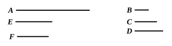

I say that $A$ will not be measured by any other prime number 
except $B$, $C$, $D$.

For, if possible, let it be measured by the prime number 
$E$, and let $E$ not be the same with any one of the numbers 
$B$, $C$, $D$.

Now, since $E$ measures $A$, let it measure it according 
to $F$ ;

therefore $E$ by multiplying $F$ has made $A$.

And $A$ is measured by the prime numbers $B$, $C$, $D$.

But, if two numbers by multiplying one another make some 
number, and any prime number measure the product, it will 
also measure one of the original numbers ; [VII. 30]

therefore $B$, $C$, $D$ will measure one of the numbers $E$, $F$.

Now they will not measure $E$ ; 
for $E$ is prime and not the same with any one of the numbers 
$B$, $C$, $D$.

Therefore they will measure $F$, which is less than $A$ : 
which is impossible, for $A$ is by hypothesis the least number 
measured by $B$, $C$, $D$.

Therefore no prime number will measure $A$ except 
$B$, $C$, $D$.

Q. E. D.

---

In other words, a number can be resolved into prime factors in only 
one way.

Let $a$ be the least number measured by each of the prime numbers 
$b, c, d, \dots k$.

If possible, suppose that $a$ has a prime factor $p$ different from $b, c, d, \dots k$.

Let
$$a = p \cdot m.$$

Now $b, c, d, \dots k$, measuring $a$, must measure one of the two factors $p, m$. [VII. 30]

They do not, by hypothesis, measure $p$ ; 
therefore they must measure $m$, a number less than $a$ : 
which is contrary to the hypothesis.

Therefore $a$ has no prime factors except $b, c, d, \dots k$.
