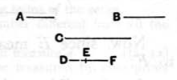

### PROPOSITION 15.

*If three numbers in continued proportion be the least of those which have the same ratio with them, any two whatever added together will be prime to the remaining number.*

Let $A, B, C$, three numbers in continued proportion, be the least of those which have the same ratio with them;  
I say that any two of the numbers $A, B, C$ whatever added together are prime to the remaining number, namely $A, B$ to $C$; $B, C$ to $A$; and further $A, C$ to $B$.

For let two numbers $DE, EF$, the least of those which have the same ratio with $A, B, C$, be taken. [^404_1]

It is then manifest that $DE$ by multiplying itself has made $A$, and by multiplying $EF$ has made $B$, and, further, $EF$ by multiplying itself has made $C$. [^404_2]

Now, since $DE, EF$ are least,  
they are prime to one another. [^404_3]

But, if two numbers be prime to one another,  
their sum is also prime to each; [^404_4]  
therefore $DF$ is also prime to each of the numbers $DE, EF$.

But further $DE$ is also prime to $EF$;  
therefore $DF, DE$ are prime to $EF$.

But, if two numbers be prime to any number,  
their product is also prime to the other; [^404_5]  
so that the product of $FD, DE$ is prime to $EF$;  
hence the product of $FD, DE$ is also prime to the square on $EF$. [^404_6]

But the product of $FD, DE$ is the square on $DE$ together with the product of $DE, EF$; [^404_7]  
therefore the square on $DE$ together with the product of $DE, EF$ is prime to the square on $EF$.

And the square on $DE$ is $A$,  
the product of $DE, EF$ is $B$,  
and the square on $EF$ is $C$;  
therefore $A, B$ added together are prime to $C$.

[^404_1]: [VIII. 2]
[^404_2]: [VIII. 2]
[^404_3]: [VII. 22]
[^404_4]: [VII. 28]
[^404_5]: [VII. 24]
[^404_6]: [VII. 25]
[^404_7]: [II. 3]
