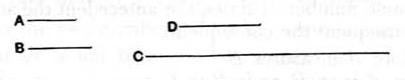

Next, let _A_, _B_ not be prime to one another, and let _B_ by multiplying itself make _C_.

Then _A_ either measures _C_ or does not measure it.

First, let it measure it according to _D_; therefore _A_ by multiplying _D_ has made _C_.

But, further, _B_ has also by multiplying itself made _C_; therefore the product of _A_, _D_ is equal to the square on _B_.

Therefore, as _A_ is to _B_, so is _B_ to _D_; [VII. 19] therefore a third proportional number _D_ has been found to _A_, _B_.

Next, let _A_ not measure _C_; I say that it is impossible to find a third proportional number to _A_, _B_.

For, if possible, let _D_, such third proportional, have been found.

Therefore the product of _A_, _D_ is equal to the square on _B_.

But the square on _B_ is _C_; therefore the product of _A_, _D_ is equal to _C_.

Hence _A_ by multiplying _D_ has made _C_; therefore _A_ measures _C_ according to _D_.

But, by hypothesis, it also does not measure it: which is absurd.

Therefore it is not possible to find a third proportional number to _A_, _B_ when _A_ does not measure _C_.

Q. E. D.

---

Given two numbers _a_, _b_, to find the condition that they may have an integral third proportional.

(1) _a_, _b_ must not be prime to one another. [IX. 16]

(2) _a_ must measure _b_².

For, if _a_, _b_, _c_ be in continued proportion,
$$ac = b^2.$$

Therefore _a_ measures _b_².

Condition (1) is included in condition (2) since, if $b^2 = ma$, _a_ and _b_ cannot be prime to one another.

The result is of course easily seen if the three terms in continued proportion be written
$$a,\quad a\frac{b}{a},\quad a\left(\frac{b}{a}\right)^2.$$
