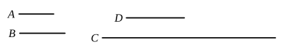

Next, let $A$, $B$ not be prime to one another, 
and let $B$ by multiplying itself make $C$.

Then $A$ either measures $C$ or does not measure it.

First, let it measure it according to $D$ ;

therefore $A$ by multiplying $D$ has made $C$.

But, further, $B$ has also by multiplying itself made $C$ ;

therefore the product of $A$, $D$ is equal to the square on $B$.

Therefore, as $A$ is to $B$, so is $B$ to $D$ ; [VII. 19] 
therefore a third proportional number $D$ has been found to 
$A$, $B$.

Next, let $A$ not measure $C$ ; 
I say that it is impossible to find a third proportional number 
to $A$, $B$.

For, if possible, let $D$, such third proportional, have been 
found.

Therefore the product of $A$, $D$ is equal to the square on $B$.

But the square on $B$ is $C$ ;

therefore the product of $A$, $D$ is equal to $C$.

Hence $A$ by multiplying $D$ has made $C$ ; 
therefore $A$ measures $C$ according to $D$.

But, by hypothesis, it also does not measure it :

which is absurd.

Therefore it is not possible to find a third proportional 
number to $A$, $B$ when $A$ does not measure $C$.

Q. E. D.

---

Given two numbers *a*, *b*, to find the condition that they may have an 
integral third proportional.

(1) *a*, *b* must not be prime to one another. [IX. 16]

(2) *a* must measure *b*².

For, if *a*, *b*, *c* be in continued proportion,
$$ac = b^2.$$

Therefore *a* measures *b*².

Condition (1) is included in condition (2) since, if $b^2 = ma$, *a* and *b* cannot 
be prime to one another.

The result is of course easily seen if the three terms in continued 
proportion be written
$$a,\quad a\frac{b}{a},\quad a\left(\frac{b}{a}\right)^2.$$
