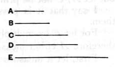

### PROPOSITION 19.

_Given three numbers, to investigate when it is possible to find a fourth proportional to them._

Let _A_, _B_, _C_ be the given three numbers, and let it be required to investigate when it is possible to find a fourth proportional to them.

Now either they are not in continued proportion, and the extremes of them are prime to one another;
or they are in continued proportion, and the extremes of them are not prime to one another;
or they are not in continued proportion, nor are the extremes of them prime to one another;
or they are in continued proportion, and the extremes of them are prime to one another.

If then _A_, _B_, _C_ are in continued proportion, and the extremes of them _A_, _C_ are prime to one another, it has been proved that it is impossible to find a fourth proportional number to them. [IX. 17]

†Next, let _A_, _B_, _C_ not be in continued proportion, the extremes being again prime to one another;
I say that in this case also it is impossible to find a fourth proportional to them.

For, if possible, let _D_ have been found, so that,
$$\text{as } A \text{ is to } B\text{, so is } C \text{ to } D\text{,}$$
and let it be contrived that, as _B_ is to _C_, so is _D_ to _E_.

Now, since, as _A_ is to _B_, so is _C_ to _D_,
and, as _B_ is to _C_, so is _D_ to _E_,
therefore, _ex aequali_, as _A_ is to _C_, so is _C_ to _E_. [VII. 14]

But _A_, _C_ are prime, primes are also least, [VII. 21] and the least numbers measure those which have the same ratio, the antecedent the antecedent and the consequent the consequent. [VII. 20]

Therefore _A_ measures _C_ as antecedent antecedent.
