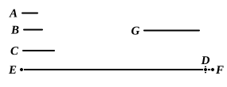

August adopts Theon’s form of the proof. Heiberg does not feel able to 
do this, in view of the superiority of the authority for the text as given above 
(P) ; he therefore retains the latter without any attempt to emend it.

---

### PROPOSITION 20.

Prime numbers are more than any assigned multitude of 
prime numbers.

Let $A$, $B$, $C$ be the assigned prime numbers ; 
I say that there are more 
prime numbers than $A$, $B$, $C$.

For let the least number 
measured by $A$, $B$, $C$ be 
taken, 
and let it be $DE$ ; 
let the unit $DF$ be added to $DE$.

Then $EF$ is either prime or not.

First, let it be prime ;

then the prime numbers $A$, $B$, $C$, $EF$ have been found which 
are more than $A$, $B$, $C$.

Next, let $EF$ not be prime ;

therefore it is measured by some prime number. [VII. 31]

Let it be measured by the prime number $G$.

I say that $G$ is not the same with any of the numbers 
$A$, $B$, $C$.

For, if possible, let it be so.

Now $A$, $B$, $C$ measure $DE$ ;

therefore $G$ also will measure $DE$.

But it also measures $EF$.

Therefore $G$, being a number, will measure the remainder, 
the unit $DF$ : 
which is absurd.

Therefore $G$ is not the same with any one of the numbers 
$A$, $B$, $C$.

And by hypothesis it is prime.

Therefore the prime numbers $A$, $B$, $C$, $G$ have been found 
which are more than the assigned multitude of $A$, $B$, $C$.

Q. E. D.

