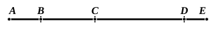

We have here the important proposition that *the number of prime numbers is infinite*.

The proof will be seen to be the same as that given in our algebraical text-books. Let *a, b, c, ... k* be any prime numbers.  
Take the product *abc ... k* and add unity.  
Then (*abc ... k* + 1) is either a prime number or not a prime number.  
(1) If it *is*, we have added another prime number to those given.  
(2) If it is *not*, it must be measured by some prime number [VII. 31], say *p*.  
Now *p* cannot be identical with any of the prime numbers *a, b, c, ... k*.  
For, if it is, it will divide *abc ... k*.  
Therefore, since it divides (*abc ... k* + 1) also, it will measure the difference, or unity:  
which is impossible.  
Therefore in any case we have obtained one fresh prime number.  
And the process can be carried on to any extent.

---

### PROPOSITION 21.

*If as many even numbers as we please be added together, the whole is even.*

For let as many even numbers as we please, $AB$, $BC$, $CD$, $DE$, be added together;  
I say that the whole $AE$ is even.

For, since each of the numbers $AB$, $BC$, $CD$, $DE$ is even, it has a half part; [VII. Def. 6]  
so that the whole $AE$ also has a half part.  
But an even number is that which is divisible into two equal parts; [id.]  
therefore $AE$ is even.

Q. E. D.

---

In this and the following propositions up to IX. 34 inclusive we have a number of theorems about odd, even, “even-times even” and “even-times odd” numbers respectively. They are all simple and require no explanation in order to enable them to be followed easily.

---

### PROPOSITION 22.

*If as many odd numbers as we please be added together, and their multitude be even, the whole will be even.*

For let as many odd numbers as we please, $AB$, $BC$, $CD$, $DE$, even in multitude, be added together;  
I say that the whole $AE$ is even.
