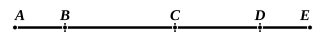
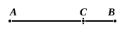

For, since each of the numbers $AB$, $BC$, $CD$, $DE$ is odd, if an unit be subtracted from each, each of the remainders will be even; [VII. Def. 7]  
so that the sum of them will be even. [IX. 21]

But the multitude of the units is also even.  
Therefore the whole $AE$ is also even. [IX. 21]

Q. E. D.

---

### PROPOSITION 23.

*If as many odd numbers as we please be added together, and their multitude be odd, the whole will also be odd.*

For let as many odd numbers as we please, $AB$, $BC$, $CD$, the multitude of which is odd,[^414_1] be added together;  
I say that the whole $AD$ is also odd.

Let the unit $DE$ be subtracted from $CD$;  
therefore the remainder $CE$ is even. [VII. Def. 7]  
But $CA$ is also even; [IX. 22]  
therefore the whole $AE$ is also even. [IX. 21]  
And $DE$ is an unit.  
Therefore $AD$ is odd. [VII. Def. 7]

Q. E. D.

[^414_1]: 3. Literally “let there be as many numbers as we please, of which *let the multitude be odd*.” This form, natural in Greek, is awkward in English.

---

### PROPOSITION 24.

*If from an even number an even number be subtracted, the remainder will be even.*

For from the even number $AB$ let the even number $BC$ be subtracted:  
I say that the remainder $CA$ is even.

For, since $AB$ is even, it has a half part. [VII. Def. 6]
