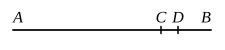
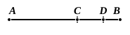

For the same reason $BC$ also has a half part ;

so that the remainder [$CA$ also has a half part, and] $AC$ is 
therefore even.

Q. E. D.

---

### PROPOSITION 25.

If from an even number an odd number be subtracted, the 
remainder will be odd.

For from the even number $AB$ let the odd number $BC$ be 
subtracted ; 
I say that the remainder $CA$ is odd.

For let the unit $CD$ be sub- 
tracted from $BC$ ;

therefore $DB$ is even. [VII. Def. 7]

But $AB$ is also even ;

therefore the remainder $AD$ is also even. [IX. 24]

And $CD$ is an unit ;

therefore $CA$ is odd. [VII. Def. 7]

Q. E. D.

---

### PROPOSITION 26.

If from an odd number an odd number be subtracted, the 
remainder will be even.

For from the odd number $AB$ let the odd number $BC$ be 
subtracted ; 
I say that the remainder $CA$ is even.

For, since $AB$ is odd, let the unit 
$BD$ be subtracted ;

therefore the remainder $AD$ is even. [VII. Def. 7]

For the same reason $CD$ is also even ; [VII. Def. 7]

so that the remainder $CA$ is also even. [IX. 24]

Q. E. D.

