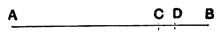
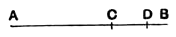

For the same reason *BC* also has a half part;  
so that the remainder [*CA* also has a half part, and] *AC* is therefore even.

Q. E. D.

---

### PROPOSITION 25.

*If from an even number an odd number be subtracted, the remainder will be odd.*

For from the even number *AB* let the odd number *BC* be subtracted;  
I say that the remainder *CA* is odd.

For let the unit *CD* be subtracted from *BC*;  
therefore *DB* is even. [VII. Def. 7]  
But *AB* is also even;  
therefore the remainder *AD* is also even. [IX. 24]  
And *CD* is an unit;  
therefore *CA* is odd. [VII. Def. 7]

Q. E. D.

---

### PROPOSITION 26.

*If from an odd number an odd number be subtracted, the remainder will be even.*

For from the odd number *AB* let the odd number *BC* be subtracted;  
I say that the remainder *CA* is even.

For, since *AB* is odd, let the unit *BD* be subtracted;  
therefore the remainder *AD* is even. [VII. Def. 7]  
For the same reason *CD* is also even; [VII. Def. 7]  
so that the remainder *CA* is also even. [IX. 24]

Q. E. D.

