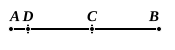
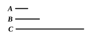
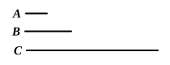

### PROPOSITION 27.

*If from an odd number an even number be subtracted, the remainder will be odd.*

For from the odd number $AB$ let the even number $BC$ be subtracted;  
I say that the remainder $CA$ is odd.

Let the unit $AD$ be subtracted;  
therefore $DB$ is even. [VII. Def. 7]  
But $BC$ is also even;  
therefore the remainder $CD$ is even. [IX. 24]  
Therefore $CA$ is odd. [VII. Def. 7]

Q. E. D.

---

### PROPOSITION 28.

*If an odd number by multiplying an even number make some number, the product will be even.*

For let the odd number $A$ by multiplying the even number $B$ make $C$;  
I say that $C$ is even.

For, since $A$ by multiplying $B$ has made $C$,  
therefore $C$ is made up of as many numbers equal to $B$ as there are units in $A$. [VII. Def. 15]  
And $B$ is even;  
therefore $C$ is made up of even numbers.  
But, if as many even numbers as we please be added together, the whole is even. [IX. 21]  
Therefore $C$ is even.

Q. E. D.

---

### PROPOSITION 29.

*If an odd number by multiplying an odd number make some number, the product will be odd.*

For let the odd number $A$ by multiplying the odd number $B$ make $C$;  
I say that $C$ is odd.

For, since $A$ by multiplying $B$ has made $C$,
