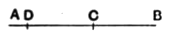
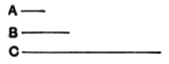
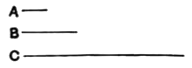

### PROPOSITION 27.

*If from an odd number an even number be subtracted, the remainder will be odd.*

For from the odd number *AB* let the even number *BC* be subtracted;  
I say that the remainder *CA* is odd.

Let the unit *AD* be subtracted;  
therefore *DB* is even. [VII. Def. 7]  
But *BC* is also even;  
therefore the remainder *CD* is even. [IX. 24]  
Therefore *CA* is odd. [VII. Def. 7]

Q. E. D.

---

### PROPOSITION 28.

*If an odd number by multiplying an even number make some number, the product will be even.*

For let the odd number *A* by multiplying the even number *B* make *C*;  
I say that *C* is even.

For, since *A* by multiplying *B* has made *C*,  
therefore *C* is made up of as many numbers equal to *B* as there are units in *A*. [VII. Def. 15]  
And *B* is even;  
therefore *C* is made up of even numbers.  
But, if as many even numbers as we please be added together, the whole is even. [IX. 21]  
Therefore *C* is even.

Q. E. D.

---

### PROPOSITION 29.

*If an odd number by multiplying an odd number make some number, the product will be odd.*

For let the odd number *A* by multiplying the odd number *B* make *C*;  
I say that *C* is odd.

For, since *A* by multiplying *B* has made *C*,
