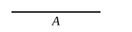
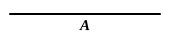

See the notes on VII. Deff. 8 to 11 for a discussion of the difficulties shown by Iamblichus to be involved by the Euclidean definitions of “even-times even,” “even-times odd” and “odd-times even.”

---

### PROPOSITION 33.

*If a number have its half odd, it is even-times odd only.*

For let the number $A$ have its half odd;  
I say that $A$ is even-times odd only.

Now that it is even-times odd is manifest; for the half of it, being odd, measures it an even number of times. [VII. Def. 9]

I say next that it is also even-times odd only.

For, if $A$ is even-times even also, it will be measured by an even number according to an even number; [VII. Def. 8] so that the half of it will also be measured by an even number though it is odd: which is absurd.

Therefore $A$ is even-times odd only.

**Q. E. D.**

---

### PROPOSITION 34.

*If a number neither be one of those which are continually doubled from a dyad, nor have its half odd, it is both even-times even and even-times odd.*

For let the number $A$ neither be one of those doubled from a dyad, nor have its half odd;  
I say that $A$ is both even-times even and even-times odd.

Now that $A$ is even-times even is manifest; for it has not its half odd. [VII. Def. 8]

I say next that it is also even-times odd.

For, if we bisect $A$, then bisect its half, and do this continually, we shall come upon some odd number which will measure $A$ according to an even number.

For, if not, we shall come upon a dyad, and $A$ will be among those which are doubled from a dyad: which is contrary to the hypothesis.
