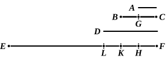

Thus $A$ is even-times odd.

But it was also proved even-times even.

Therefore $A$ is both even-times even and even-times odd.

Q. E. D.

---

### PROPOSITION 35.

If as many numbers as we please be in continued proportion, 
and there be subtracted from the second and the last numbers 
equal to the first, then, as the excess of the second is to the 
first, so will the excess of the last be to all those before it.

Let there be as many numbers as we please in continued 
proportion, $A$, $BC$, $D$, $EF$, 
beginning from $A$ as least, 
and let there be subtracted 
from $BC$ and $EF$ the numbers 
$BG$, $FH$, each equal to $A$; 
I say that, as $GC$ is to $A$, so 
is $EH$ to $A$, $BC$, $D$.

For let $FK$ be made equal to $BC$, and $FL$ equal to $D$.

Then, since $FK$ is equal to $BC$, 
and of these the part $FH$ is equal to the part $BG$,

therefore the remainder $HK$ is equal to the remainder $GC$.

And since, as $EF$ is to $D$, so is $D$ to $BC$, and $BC$ to $A$, 
while $D$ is equal to $FL$, $BC$ to $FK$, and $A$ to $FH$,

therefore, as $EF$ is to $FL$, so is $LF$ to $FK$, and $FK$ to $FH$.

Separando, as $EL$ is to $LF$, so is $LK$ to $FK$, and $KH$ 
to $FH$. [VII. 11, 13]

Therefore also, as one of the antecedents is to one of the 
consequents, so are all the antecedents to all the consequents; [VII. 12] 
therefore, as $KH$ is to $FH$, so are $EL$, $LK$, $KH$ to $LF$, 
$FK$, $HF$.

But $KH$ is equal to $CG$, $FH$ to $A$, and $LF$, $FK$, $HF$ to 
$D$, $BC$, $A$;

therefore, as $CG$ is to $A$, so is $EH$ to $D$, $BC$, $A$.

Therefore, as the excess of the second is to the first, so is 
the excess of the last to all those before it.

Q. E. D.

