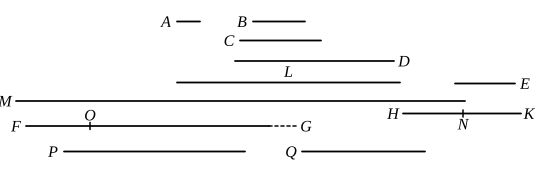

Therefore the product of *E*, *D* is equal to the product of *A*, *M*. [VII. 19]

And the product of *E*, *D* is *FG*;  
therefore the product of *A*, *M* is also *FG*.

Therefore *A* by multiplying *M* has made *FG*;  
therefore *M* measures *FG* according to the units in *A*.

And *A* is a dyad;  
therefore *FG* is double of *M*.

But *M*, *L*, *HK*, *E* are continuously double of each other;  
therefore *E*, *HK*, *L*, *M*, *FG* are continuously proportional in double proportion.

Now let there be subtracted from the second *HK* and the last *FG* the numbers *HN*, *FO*, each equal to the first *E*;  
therefore, as the excess of the second is to the first, so is the excess of the last to all those before it. [IX. 35]

Therefore, as *NK* is to *E*, so is *OG* to *M*, *L*, *KH*, *E*.

And *NK* is equal to *E*;  
therefore *OG* is also equal to *M*, *L*, *HK*, *E*.

But *FO* is also equal to *E*, and *E* is equal to *A*, *B*, *C*, *D* and the unit.

Therefore the whole *FG* is equal to *E*, *HK*, *L*, *M* and *A*, *B*, *C*, *D* and the unit; and it is measured by them.

I say also that *FG* will not be measured by any other number except *A*, *B*, *C*, *D*, *E*, *HK*, *L*, *M* and the unit.

For, if possible, let some number *P* measure *FG*, and let *P* not be the same with any of the numbers *A*, *B*, *C*, *D*, *E*, *HK*, *L*, *M*.

And, as many times as *P* measures *FG*, so many units let there be in *Q*;  
therefore *Q* by multiplying *P* has made *FG*.
