columns should be found to agree in the model and the original as far as the millionth railing. This proves only that the railing distance of the model does not err by the millionth part of the corresponding column distance. We can thus fix limits to the disproportion, if any, and we may make those limits as small as we please, by carrying on the method of *observation*; but we cannot *observe* an infinite number of cases and so enable ourselves to affirm proportion absolutely. Mathematical methods however enable us to avoid the difficulty. We can take *any multiples whatever* and work with them as if they were particular multiples. De Morgan gives, as an instance to show that the definition of proportion can in practice be used, notwithstanding its infinite character, the following proof of a proposition to the same effect as Eucl. VI. 2.

"Let $OAB$ be a triangle to one side $AB$ of which $ab$ is drawn parallel, and on $OA$ produced set off $AA_2$, $A_2A_3$ etc. equal to $OA$, and $aa_2$, $a_2a_3$ etc. equal to $Oa$.

Through every one of the points so obtained draw parallels to $AB$, meeting $OB$ produced in $b_2$, $B_2$ etc.

Then it is easily proved that $bb_2$, $b_2b_3$ etc. are severally equal to $Ob$, and $BB_2$, $B_2B_3$ etc. to $OB$.

Consequently a distribution of the multiples of $OA$ among the multiples of $Oa$ is made on one line, and of $OB$ among those of $Ob$ on the other.

The examination of this distribution in all its extent (which is impossible, and hence the apparent difficulty of using the definition) is rendered unnecessary by the known property of parallel lines. For, since $A_3$ lies between $a_3$ and $a_4$, $B_3$ must lie between $b_3$ and $b_4$; for, if not, the line $A_3B_3$ would cut either $a_3b_3$ or $a_4b_4$.

Hence, without inquiring where $A_m$ *does* fall, we know that, if it fall between $a_n$ and $a_{n+1}$, $B_m$ must fall between $b_n$ and $b_{n+1}$; or, if $m \cdot OA$ fall in magnitude between $n \cdot Oa$ and $(n+1)Oa$, then $m \cdot OB$ must fall between $n \cdot Ob$ and $(n+1)Ob$."

Max Simon remarks (*Euclid und die sechs planimetrischen Bücher*, p. 110), after Zeuthen, that Euclid's definition of equal ratios is word for word the same as Weierstrass' definition of equal numbers. So far from agreeing in the usual view that the Greeks saw in the irrational no *number*, Simon thinks it is clear from Eucl. V. that they possessed a notion of number in all its generality as clearly defined as, nay almost identical with, Weierstrass' conception of it.

Certain it is that there is an exact correspondence, almost coincidence, between Euclid's definition of equal ratios and the modern theory of irrationals due to Dedekind. Premising the ordinal arrangement of natural numbers in ascending order, then enlarging the sphere of numbers by including (1) negative numbers as well as positive, (2) fractions, as $a/b$, where $a, b$ may
