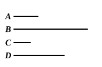

Let the first $A$ be the same *multiple* of $B$ the second that $C$ the third is of the fourth $D$ ;

$$A \text{ is to } B \text{ as } C \text{ is to } D.$$

Take of $A$, $C$ any equimultiples whatever $E$, $F$ ; and of $B$, $D$ any equimultiples whatever $G$, $H$.

Then, because $A$ is the same multiple of $B$ that $C$ is of $D$,
and $E$ is the same multiple of $A$ that $F$ is of $C$,
$E$ is the same multiple of $B$ that $F$ is of $D$. [V. 3]

Therefore $E$, $F$ are the same multiples of $B$, $D$.

But $G$, $H$ are equimultiples of $B$, $D$ ;
therefore, if $E$ be a greater multiple of $B$ than $G$ is, $F$ is a greater multiple of $D$ than $H$ is of $D$ ;

that is, if $E$ be greater than $G$, $F$ is greater than $H$.

In like manner,
if $E$ be equal to $G$, or less, $F$ is equal to $H$, or less than it.

But $E$, $F$ are equimultiples, any whatever, of $A$, $C$ ;
and $G$, $H$ any equimultiples whatever of $B$, $D$.

Therefore $A$ is to $B$ as $C$ is to $D$. [V. Def. 5]

Next, let the first $A$ be the same *part* of the second $B$ that the third $C$ is of the fourth $D$ :

$$A \text{ is to } B \text{ as } C \text{ is to } D.$$

For $B$ is the same multiple of $A$ that $D$ is of $C$ ;
wherefore, by the preceding case,

$$B \text{ is to } A \text{ as } D \text{ is to } C ;$$

and, *inversely*, $A$ is to $B$ as $C$ is to $D$.

[For this last inference Simson refers to his Proposition B. That proposition is very simply proved by taking any equimultiples $E$, $F$ of $B$, $D$ and any equimultiples $G$, $H$ of $A$, $C$ and then arguing as follows :

Since $A$ is to $B$ as $C$ is to $D$,
$G$, $H$ are *simultaneously* greater than, equal to, or less than $E$, $F$ respectively ; so that
$E$, $F$ are *simultaneously* less than, equal to, or greater than $G$, $H$ respectively,
and therefore [Def. 5] $B$ is to $A$ as $D$ is to $C$.]

We have now only to add to Prop. C the case where $AB$ contains the *same parts* of $CD$ that $EF$ does of $GH$ :
in this case likewise $AB$ is to $CD$ as $EF$ to $GH$.

Let $CK$ be a part of $CD$, and $GL$ the same part of $GH$ ; let $AB$ be the same multiple of $CK$ that $EF$ is of $GL$.
