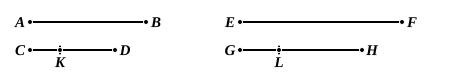

Therefore, by Prop. C,

$$AB \text{ is to } CK \text{ as } EF \text{ to } GL.$$

And $CD$, $GH$ are equimultiples of $CK$, $GL$, the second and fourth.

Therefore $AB$ is to $CD$ as $EF$ to $GH$ [Simson's Cor. to V. 4, which however is the particular case of V. 4 in which the "equimultiples" of one pair are the pair itself, i.e. the pair multiplied by unity].

To prove the partial converse we begin with Prop. D.

*If the first be to the second as the third to the fourth, and if the first be a multiple or part of the second, the third is the same multiple or the same part of the fourth.*

Let $A$ be to $B$ as $C$ is to $D$ ;
and, first, let $A$ be a multiple of $B$ ;

$$C \text{ is the same multiple of } D.$$

Take $E$ equal to $A$, and whatever multiple $A$ or $E$ is of $B$, make $F$ the same multiple of $D$.

Then, because $A$ is to $B$ as $C$ is to $D$,
and of $B$ the second and $D$ the fourth equimultiples have been taken $E$ and $F$,

$$A \text{ is to } E \text{ as } C \text{ is to } F. \quad [\text{V. 4, Cor.}]$$

But $A$ is equal to $E$ ;

$$\text{therefore } C \text{ is equal to } F.$$

[In support of this inference Simson cites his Prop. A, which however we can directly deduce from V. Def. 5 by taking any, but *the same*, equimultiples of all four magnitudes.]

Now $F$ is the same multiple of $D$ that $A$ is of $B$ ;

$$\text{therefore } C \text{ is the same multiple of } D \text{ that } A \text{ is of } B.$$

Next, let the first $A$ be a part of the second $B$ ;

$$C \text{ the third is the same part of the fourth } D.$$

Because $A$ is to $B$ as $C$ is to $D$,
*inversely*, $B$ is to $A$ as $D$ is to $C$. [Prop. B]

But $A$ is a part of $B$ ; therefore $B$ is a multiple of $A$ ;
and, by the preceding case, $D$ is the same multiple of $C$,
that is, $C$ is the same part of $D$ that $A$ is of $B$.

We have, again, only to add to Prop. D the case where $AB$ contains any parts of $CD$, and $AB$ is to $CD$ as $EF$ to $GH$ ;
then shall $EF$ contain the same parts of $GH$ that $AB$ does of $CD$.
