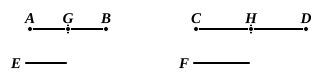

# BOOK V. PROPOSITIONS.

### PROPOSITION 1.

If there be any number of magnitudes whatever which are, 
respectively, equimultiples of any magnitudes equal in multitude, 
then, whatever multiple one of the magnitudes is of one, that 
multiple also will all be of all.

Let any number of magnitudes whatever $AB$, $CD$ be  
respectively equimultiples of any magnitudes $E$, $F$ equal in  
multitude;

I say that, whatever multiple $AB$ is of $E$, that multiple will  
$AB$, $CD$ also be of $E$, $F$.

For, since $AB$ is the same multiple of $E$ that $CD$ is of $F$,  
as many magnitudes as there are in $AB$ equal to $E$, so many  
also are there in $CD$ equal to $F$.

Let $AB$ be divided into the magnitudes $AG$, $GB$ equal  
to $E$,  
and $CD$ into $CH$, $HD$ equal to $F$;  
then the multitude of the magnitudes $AG$, $GB$ will be equal  
to the multitude of the magnitudes $CH$, $HD$.

Now, since $AG$ is equal to $E$, and $CH$ to $F$,

therefore $AG$ is equal to $E$, and $AG$, $CH$ to $E$, $F$.

For the same reason

$GB$ is equal to $E$, and $GB$, $HD$ to $E$, $F$;

therefore, as many magnitudes as there are in $AB$ equal to $E$, 
so many also are there in $AB$, $CD$ equal to $E$, $F$;

