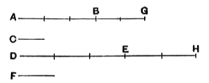

therefore, whatever multiple $AB$ is of $E$, that multiple will $AB$, $CD$ also be of $E$, $F$.

Therefore etc.

Q. E. D.

---

De Morgan remarks of V. 1—6 that they are "simple propositions of concrete arithmetic, covered in language which makes them unintelligible to modern ears. The first, for instance, states no more than that *ten* acres and *ten* roods make *ten* times as much as one acre and one rood." One aim therefore of notes on these as well as the other propositions of Book V. should be to make their purport clearer to the learner by setting them side by side with the same truths expressed in the much shorter and more familiar modern (algebraical) notation. In doing so, we shall express magnitudes by the first letters of the alphabet, $a$, $b$, $c$ etc., adopting small instead of capital letters so as to avoid confusion with Euclid's lettering; and we shall use the small letters $m$, $n$, $p$ etc. to represent integral numbers. Thus $ma$ will always mean $m$ times $a$ or the $m^{\text{th}}$ multiple of $a$ (counting $1.a$ as the first, $2.a$ as the second multiple, and so on).

Prop. 1 then asserts that, if $ma$, $mb$, $mc$ etc. be any equimultiples of $a$, $b$, $c$ etc., then

$$ma + mb + mc + \dots = m(a + b + c + \dots).$$

---

## PROPOSITION 2.

*If a first magnitude be the same multiple of a second that a third is of a fourth, and a fifth also be the same multiple of the second that a sixth is of the fourth, the sum of the first and fifth will also be the same multiple of the second that the sum of the third and sixth is of the fourth.*

Let a first magnitude, $AB$, be the same multiple of a second, $C$, that a third, $DE$, is of a fourth, $F$, and let a fifth, $BG$, also be the same multiple of the second, $C$, that a sixth, $EH$, is of the fourth $F$;

I say that the sum of the first and fifth, $AG$, will be the same multiple of the second, $C$, that the sum of the third and sixth, $DH$, is of the fourth, $F$.

For, since $AB$ is the same multiple of $C$ that $DE$ is of $F$, therefore, as many magnitudes as there are in $AB$ equal to $C$, so many also are there in $DE$ equal to $F$.

For the same reason also,
as many as there are in $BG$ equal to $C$, so many are there also in $EH$ equal to $F$;
