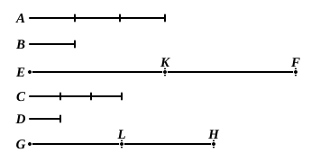

Let $EF$ be divided into the magnitudes $EK$, $KF$ equal  
to $A$, and $GH$ into the magnitudes $GL$, $LH$ equal to $C$;  
then the multitude of the magnitudes $EK$, $KF$ will be equal  
to the multitude of the magnitudes $GL$, $LH$.

And, since $A$ is the same multiple of $B$ that $C$ is of $D$,

while $EK$ is equal to $A$, and $GL$ to $C$,

therefore $EK$ is the same multiple of $B$ that $GL$ is of $D$.

For the same reason

$KF$ is the same multiple of $B$ that $LH$ is of $D$.

Since, then, a first magnitude $EK$ is the same multiple  
of a second $B$ that a third $GL$ is of a fourth $D$,  
and a fifth $KF$ is also the same multiple of the second $B$ that  
a sixth $LH$ is of the fourth $D$,

therefore the sum of the first and fifth, $EF$, is also the same 
multiple of the second $B$ that the sum of the third and sixth, 
$GH$, is of the fourth $D$. [V. 2]

Therefore etc.Q. E. D.

---

Heiberg remarks of the use of *ex aequali* in the enunciation of this proposition that, strictly speaking, it has no reference to the definition (17) of a *ratio ex aequali*. But the uses of the expression here and in the definition are, I think, sufficiently parallel, as may be seen thus. The proposition asserts that, if

$$na, nb \text{ are equimultiples of } a, b,$$

and if

$$m.na, m.nb \text{ are equimultiples of } na, nb,$$

then $m.na$ is the same multiple of $a$ that $m.nb$ is of $b$. Clearly the proposition can be extended by taking further equimultiples of the last equimultiples and so on; and we can prove that

$$p.q\dots m.na \text{ is the same multiple of } a \text{ that } p.q\dots m.nb \text{ is of } b,$$

where the series of numbers $p.q\dots m.n$ is exactly the same in both expressions;
and *ex aequali* ($\delta\iota\text{'} \text{ }\ἴ\sigma\omicron\upsilon$) expresses the fact that the equimultiples are *at the same distance* from $a$, $b$ in the series $na$, $m.na \dots$ and $nb$, $m.nb \dots$ respectively.
