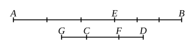

The proof, of course, follows exactly the method of Euclid's proposition itself, with the only difference that, instead of one of the two pairs of equimultiples, the magnitudes themselves are taken. In other words, the conclusion that

$$ma \text{ is to } nb \text{ as } mc \text{ is to } nd$$

is equally true when either $m$ or $n$ is equal to unity.

As De Morgan says, Simson's corollary is only necessary to those who will not admit $M$ into the list $M, 2M, 3M$ etc.; the exclusion is grammatical and nothing else. The same may be said of Simson's Prop. A to the effect that, "If the first of four magnitudes has to the second the same ratio which the third has to the fourth : then, if the first be greater than the second, the third is also greater than the fourth ; and if equal, equal ; if less, less." This is needless to those who believe *once* A to be a proper component of the list of multiples, in spite of *multus* signifying many.

---

## PROPOSITION 5.

*If a magnitude be the same multiple of a magnitude that a part subtracted is of a part subtracted, the remainder will also be the same multiple of the remainder that the whole is of the whole.*

5 For let the magnitude $AB$ be the same multiple of the magnitude $CD$ that the part $AE$ subtracted is of the part $CF$ subtracted ;

I say that the remainder $EB$ is also the same multiple of the remainder $FD$ that the whole $AB$ is of the whole $CD$.

10 For, whatever multiple $AE$ is of $CF$, let $EB$ be made that multiple of $CG$.[^146_1]

Then, since $AE$ is the same multiple of $CF$ that $EB$ is of $GC$,

therefore $AE$ is the same multiple of $CF$ that $AB$ is of $GF$. [V. 1]

15 But, by the assumption, $AE$ is the same multiple of $CF$ that $AB$ is of $CD$.

Therefore $AB$ is the same multiple of each of the magnitudes $GF$, $CD$ ;

therefore $GF$ is equal to $CD$.

20 Let $CF$ be subtracted from each ;

therefore the remainder $GC$ is equal to the remainder $FD$.
