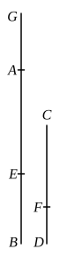

And, since $AE$ is the same multiple of $CF$ that $EB$ is of $GC$,

and $GC$ is equal to $DF$,

25 therefore $AE$ is the same multiple of $CF$ that $EB$ is of $FD$.

But, by hypothesis,

$AE$ is the same multiple of $CF$ that $AB$ is of $CD$ ;

therefore $EB$ is the same multiple of $FD$ that $AB$ is of $CD$.

That is, the remainder $EB$ will be the same multiple of 30 the remainder $FD$ that the whole $AB$ is of the whole $CD$.

Therefore etc.

Q. E. D.

[^146_1]: **10. let EB be made that multiple of CG**, $\tau\omicron\sigma\alpha\upsilon\tau\alpha\pi\lambda\\sigma\iota\omicron\nu\ \gamma\epsilon\gamma\omicron\nu\epsilontonos\tau\omega\ \kappa\alpha\grave{\iota}\ \tau\grave{\omicron}\ \text{EB}\ \tau\omicron\tilde{\upsilon}\ \Gamma\text{H}$. From this way of stating the construction one might suppose that $CG$ was given and $EB$ had to be found equal to a certain multiple of it. But in fact $EB$ is what is given and $CG$ has to be found, i.e. $CG$ has to be constructed as a certain *submultiple* of $EB$.

---

This proposition corresponds to V. 1, with subtraction taking the place of addition. It proves the formula

$$ma - mb = m(a - b).$$

Euclid's construction assumes that, if $AE$ is any multiple of $CF$, and $EB$ is any other magnitude, a fourth straight line can be found such that $EB$ is the same multiple of it that $AE$ is of $CF$, or in other words that, given any magnitude, we can divide it into any number of equal parts. This is however not proved, even of straight lines, much less other magnitudes, until VI. 9. Peletarius had already seen this objection to the construction. The difficulty is not got over by regarding it merely as a *hypothetical* construction ; for hypothetical constructions are not in Euclid's manner. The remedy is to substitute the alternative construction given by Simson, after Peletarius and Campanus' translation from the Arabic, which only requires us to add a magnitude to itself a certain number of times. The demonstration follows Euclid's line exactly.

"Take $AG$ the same multiple of $FD$ that $AE$ is of $CF$ ;

therefore $AE$ is the same multiple of $CF$ that $EG$ is of $CD$. [V. 1]

But $AE$, by hypothesis, is the same multiple of $CF$ that $AB$ is of $CD$ ; therefore $EG$ is the same multiple of $CD$ that $AB$ is of $CD$ ;

wherefore $EG$ is equal to $AB$.

Take from them the common magnitude $AE$ ; the remainder $AG$ is equal to the remainder $EB$.

Wherefore, since $AE$ is the same multiple of $CF$ that $AG$ is of $FD$, and since $AG$ is equal to $EB$,

therefore $AE$ is the same multiple of $CF$ that $EB$ is of $FD$.

But $AE$ is the same multiple of $CF$ that $AB$ is of $CD$ ;

therefore $EB$ is the same multiple of $FD$ that $AB$ is of $CD$."
