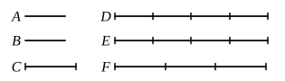

Let $CH$ be subtracted from each ;

therefore the remainder $KC$ is equal to the remainder $HD$.

But $F$ is equal to $KC$ ;

therefore $HD$ is also equal to $F$.

Hence, if $GB$ is equal to $E$, $HD$ is also equal to $F$.

Similarly we can prove that, even if $GB$ be a multiple of $E$, $HD$ is also the same multiple of $F$.

Therefore etc.

Q. E. D.

---

This proposition corresponds to V. 2, with subtraction taking the place of addition. It asserts namely that, if $n$ is less than $m$, $ma - na$ is the same multiple of $a$ that $mb - nb$ is of $b$. The enunciation distinguishes the cases in which $m - n$ is equal to $1$ and greater than $1$ respectively.

Simson observes that, while only the first case (the simpler one) is proved in the Greek, both are given in the Latin translation from the Arabic ; and he supplies accordingly the proof of the second case, which Euclid leaves to the reader. The fact is that it is exactly the same as the other except that, in the construction, $CK$ is made the same multiple of $F$ that $GB$ is of $E$, and at the end, when it has been proved that $KC$ is equal to $HD$, instead of concluding that $HD$ is equal to $F$, we have to say "Because $GB$ is the same multiple of $E$ that $KC$ is of $F$, and $KC$ is equal to $HD$, therefore $HD$ is the same multiple of $F$ that $GB$ is of $E$."

---

## PROPOSITION 7.

*Equal magnitudes have to the same the same ratio, as also has the same to equal magnitudes.*

Let $A, B$ be equal magnitudes and $C$ any other, chance, magnitude ;

I say that each of the magnitudes $A, B$ has the same ratio to $C$, and $C$ has the same ratio to each of the magnitudes $A, B$.

For let equimultiples $D, E$ of $A, B$ be taken, and of $C$ another, chance, multiple $F$.

Then, since $D$ is the same multiple of $A$ that $E$ is of $B$, while $A$ is equal to $B$,

therefore $D$ is equal to $E$.

But $F$ is another, chance, magnitude.
