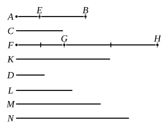

Let $AB, C$ be unequal magnitudes, and let $AB$ be greater ;
let $D$ be another, chance,
magnitude ;
I say that $AB$ has to $D$ a
greater ratio than $C$ has to
$D$, and $D$ has to $C$ a greater
ratio than it has to $AB$.

For, since $AB$ is greater
than $C$, let $BE$ be made equal
to $C$ ;
then the less of the magni-
tudes $AE, EB$, if multiplied,
will sometime be greater than $D$. [V. Def. 4]

[Case 1.]

First, let $AE$ be less than $EB$ ;
let $AE$ be multiplied, and let $FG$ be a multiple of it which is
greater than $D$ ;
then, whatever multiple $FG$ is of $AE$, let $GH$ be made the
same multiple of $EB$ and $K$ of $C$ ;
and let $L$ be taken double of $D$, $M$ triple of it, and successive
multiples increasing by one, until what is taken is a multiple
of $D$ and the first that is greater than $K$. Let it be taken,
and let it be $N$ which is quadruple of $D$ and the first
multiple of it that is greater than $K$.

Then, since $K$ is less than $N$ first,

therefore $K$ is not less than $M$.

And, since $FG$ is the same multiple of $AE$ that $GH$ is of
$EB$,

therefore $FG$ is the same multiple of $AE$ that $FH$ is of $AB$. [V. 1]

But $FG$ is the same multiple of $AE$ that $K$ is of $C$ ;

therefore $FH$ is the same multiple of $AB$ that $K$ is of $C$ ; 
therefore $FH, K$ are equimultiples of $AB, C$.

Again, since $GH$ is the same multiple of $EB$ that $K$ is
of $C$,
and $EB$ is equal to $C$,

therefore $GH$ is equal to $K$.

