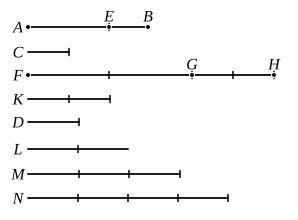

But $K$ is not less than $M$ ;

therefore neither is $GH$ less than $M$.

And $FG$ is greater than $D$ ;

therefore the whole $FH$ is greater than $D, M$ together.

But $D, M$ together are equal to $N$, inasmuch as $M$ is
triple of $D$, and $M, D$ together are quadruple of $D$, while
$N$ is also quadruple of $D$ ; whence $M, D$ together are equal
to $N$.

But $FH$ is greater than $M, D$ ;

therefore $FH$ is in excess of $N$,

while $K$ is not in excess of $N$.

And $FH, K$ are equimultiples of $AB, C$, while $N$ is
another, chance, multiple of $D$ ;

therefore $AB$ has to $D$ a greater ratio than $C$ has to $D$. [V. Def. 7]

I say next, that $D$ also has to $C$ a greater ratio than $D$
has to $AB$.

For, with the same construction, we can prove similarly
that $N$ is in excess of $K$, while $N$ is not in excess of $FH$.

And $N$ is a multiple of $D$,
while $FH, K$ are other, chance, equimultiples of $AB, C$ ;

therefore $D$ has to $C$ a greater ratio than $D$ has to $AB$. [V. Def. 7]

[Case 2.]

Again, let $AE$ be greater than $EB$.

Then the less, $EB$, if multiplied, will sometime be greater
than $D$. [V. Def. 4]

Let it be multiplied, and
let $GH$ be a multiple of $EB$
and greater than $D$ ;
and, whatever multiple $GH$ is
of $EB$, let $FG$ be made the
same multiple of $AE$, and $K$
of $C$.

Then we can prove simi-
larly that $FH, K$ are equi-
multiples of $AB, C$ ;
and, similarly, let $N$ be taken a multiple of $D$ but the first
that is greater than $FG$,
so that $FG$ is again not less than $M$.
