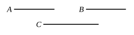

For let each of the magnitudes $A$, $B$ have the same
ratio to $C$ ;

I say that $A$ is equal to $B$.

For, otherwise, each of the
magnitudes $A$, $B$ would not
have had the same ratio to $C$ ; [V. 8]
but it has ;

therefore $A$ is equal to $B$.

Again, let $C$ have the same ratio to each of the magni-
tudes $A$, $B$ ;

I say that $A$ is equal to $B$.

For, otherwise, $C$ would not have had the same ratio to
each of the magnitudes $A$, $B$ ; [V. 8]
but it has ;

therefore $A$ is equal to $B$.

Therefore etc.Q. E. D.

---

If $A$ is to $C$ as $B$ is to $C$,
or if $C$ is to $A$ as $C$ is to $B$, then $A$ is equal to $B$.

Simson gives a more explicit proof of this proposition which has the advantage of referring back to the fundamental 5th and 7th definitions, instead of quoting the results of previous propositions, which, as will be seen from the next note, may be, in the circumstances, unsafe.

"Let $A$, $B$ have each of them the same ratio to $C$ ;
$A$ is equal to $B$.

For, if they are not equal, one of them is greater than the other ;
let $A$ be the greater.

Then, by what was shown in the preceding proposition, there are some equimultiples of $A$ and $B$, and some multiple of $C$, such that the multiple of $A$ is greater than the multiple of $C$, but the multiple of $B$ is not greater than that of $C$.

Let such multiples be taken, and let $D$, $E$ be the equimultiples of $A$, $B$, and $F$ the multiple of $C$, so that $D$ may be greater than $F$, and $E$ not greater than $F$.

But, because $A$ is to $C$ as $B$ is to $C$,
and of $A$, $B$ are taken equimultiples $D$, $E$, and of $C$ is taken a multiple $F$,
and $D$ is greater than $F$,

$E$ must also be greater than $F$. [V. Def. 5]

But $E$ is not greater than $F$ : which is impossible.

Next, let $C$ have the same ratio to each of the magnitudes $A$ and $B$ ;
$A$ is equal to $B$.

For, if not, one of them is greater than the other ;
let $A$ be the greater.
