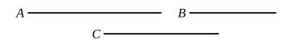

Therefore, as was shown in Prop. 8, there is some multiple $F$ of $C$, and some equimultiples $E$ and $D$ of $B$ and $A$, such that $F$ is greater than $E$ and not greater than $D$.

But, because $C$ is to $B$ as $C$ is to $A$,
and $F$ the multiple of the first is greater than $E$ the multiple of the second,
$F$ the multiple of the third is greater than $D$ the multiple of the fourth. [V. Def. 5]

But $F$ is not greater than $D$: which is impossible.
Therefore $A$ is equal to $B$."

---

### PROPOSITION 10.

*Of magnitudes which have a ratio to the same, that which has a greater ratio is greater; and that to which the same has a greater ratio is less.*

For let $A$ have to $C$ a greater ratio than $B$ has to $C$;
I say that $A$ is greater than $B$.

For, if not, $A$ is either equal to $B$ or less.
Now $A$ is not equal to $B$;
for in that case each of the magnitudes $A$, $B$ would have had the same ratio to $C$; [V. 7]
but they have not;
therefore $A$ is not equal to $B$.

Nor again is $A$ less than $B$;
for in that case $A$ would have had to $C$ a less ratio than $B$ has to $C$; [V. 8]
but it has not;
therefore $A$ is not less than $B$.

But it was proved not to be equal either;
therefore $A$ is greater than $B$.

Again, let $C$ have to $B$ a greater ratio than $C$ has to $A$;
I say that $B$ is less than $A$.

For, if not, it is either equal or greater.
Now $B$ is not equal to $A$;
for in that case $C$ would have had the same ratio to each of the magnitudes $A$, $B$; [V. 7]
but it has not;
therefore $A$ is not equal to $B$.
