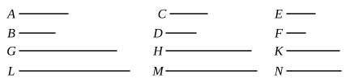

### PROPOSITION 11.

Ratios which are the same with the same ratio are also 
the same with one another.

For, as $A$ is to $B$, so let $C$ be to $D$,
and, as $C$ is to $D$, so let $E$ be to $F$;
I say that, as $A$ is to $B$, so is $E$ to $F$.

For of $A$, $C$, $E$ let equimultiples $G$, $H$, $K$ be taken, and of $B$, $D$, $F$ other, chance, equimultiples $L$, $M$, $N$.

Then since, as $A$ is to $B$, so is $C$ to $D$,
and of $A$, $C$ equimultiples $G$, $H$ have been taken,
and of $B$, $D$ other, chance, equimultiples $L$, $M$,
therefore, if $G$ is in excess of $L$, $H$ is also in excess of $M$,
if equal, equal,
and if less, less.

Again, since, as $C$ is to $D$, so is $E$ to $F$,
and of $C$, $E$ equimultiples $H$, $K$ have been taken,
and of $D$, $F$ other, chance, equimultiples $M$, $N$,
therefore, if $H$ is in excess of $M$, $K$ is also in excess of $N$,
if equal, equal,
and if less, less.

But we saw that, if $H$ was in excess of $M$, $G$ was also in excess of $L$; if equal, equal; and if less, less;
so that, in addition, if $G$ is in excess of $L$, $K$ is also in excess of $N$,
if equal, equal,
and if less, less.

And $G$, $K$ are equimultiples of $A$, $E$,
while $L$, $N$ are other, chance, equimultiples of $B$, $F$;
therefore, as $A$ is to $B$, so is $E$ to $F$.

therefore, as $A$ is to $B$, so is $E$ to $F$.

Therefore etc.

