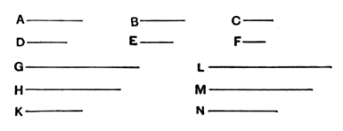

Algebraically, if
$$\begin{aligned}
a : b &= c : d, \\
\text{and}\qquad c : d &= e : f, \\
\text{then}\qquad a : b &= e : f.
\end{aligned}$$

The idiomatic use of the imperfect in quoting a result previously obtained is noteworthy. Instead of saying "But *it was proved that*, if $H$ is in excess of $M$, $G$ is also in excess of $L$," the Greek text has "But if $H$ *was* in excess of $M$, $G$ *was* also in excess of $L$," ἀλλὰ εἰ ὑπερεῖχε τὸ Θ τοῦ Μ, ὑπερεῖχε καὶ τὸ Η τοῦ Λ.

This proposition is tacitly used in combination with V. 16 and V. 24 in the geometrical passage in Aristotle, *Meteorologica* III. 5, 376 a 22—26.

---

## PROPOSITION 12.

*If any number of magnitudes be proportional, as one of the antecedents is to one of the consequents, so will all the antecedents be to all the consequents.*

Let any number of magnitudes $A$, $B$, $C$, $D$, $E$, $F$ be proportional, so that, as $A$ is to $B$, so is $C$ to $D$ and $E$ to $F$;
I say that, as $A$ is to $B$, so are $A$, $C$, $E$ to $B$, $D$, $F$.

For of $A$, $C$, $E$ let equimultiples $G$, $H$, $K$ be taken,
and of $B$, $D$, $F$ other, chance, equimultiples $L$, $M$, $N$.

Then since, as $A$ is to $B$, so is $C$ to $D$, and $E$ to $F$,
and of $A$, $C$, $E$ equimultiples $G$, $H$, $K$ have been taken,
and of $B$, $D$, $F$ other, chance, equimultiples $L$, $M$, $N$,
therefore, if $G$ is in excess of $L$, $H$ is also in excess of $M$, and $K$ of $N$,
if equal, equal,
and if less, less;
so that, in addition,
if $G$ is in excess of $L$, then $G$, $H$, $K$ are in excess of $L$, $M$, $N$,
if equal, equal,
and if less, less.
