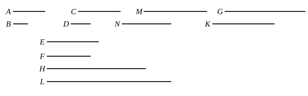

Now $G$ and $G$, $H$, $K$ are equimultiples of $A$ and $A$, $C$, $E$, since, if any number of magnitudes whatever are respectively equimultiples of any magnitudes equal in multitude, whatever multiple one of the magnitudes is of one, that multiple also will all be of all. [V. 1]

For the same reason
$L$ and $L$, $M$, $N$ are also equimultiples of $B$ and $B$, $D$, $F$;
therefore, as $A$ is to $B$, so are $A$, $C$, $E$ to $B$, $D$, $F$. [V. Def. 5]

Therefore etc.

Q. E. D.

---

Algebraically, if $a : a' = b : b' = c : c'$ etc., each ratio is equal to the ratio $(a + b + c + \dots) : (a' + b' + c' + \dots)$.

This theorem is quoted by Aristotle, *Eth. Nic.* V. 7, 1131 b 14, in the shortened form "the whole is to the whole what each part is to each part (respectively)."

---

## PROPOSITION 13.

*If a first magnitude have to a second the same ratio as a third to a fourth, and the third have to the fourth a greater ratio than a fifth has to a sixth, the first will also have to the second a greater ratio than the fifth to the sixth.*

For let a first magnitude $A$ have to a second $B$ the same ratio as a third $C$ has to a fourth $D$,
and let the third $C$ have to the fourth $D$ a greater ratio than a fifth $E$ has to a sixth $F$;
I say that the first $A$ will also have to the second $B$ a greater ratio than the fifth $E$ to the sixth $F$.

For, since there are some equimultiples of $C$, $E$,
and of $D$, $F$ other, chance, equimultiples, such that the multiple of $C$ is in excess of the multiple of $D$,
