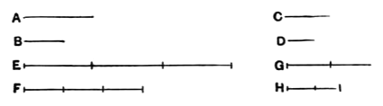

But $AG$ is equal to $C$ and $DK$ to $F$;
therefore, as $C$ is to $F$, so is $AB$ to $DE$.

Therefore etc.

Q. E. D.

---

Algebraically,
$$a : b = ma : mb.$$

---

## PROPOSITION 16.

*If four magnitudes be proportional, they will also be proportional alternately.*

Let $A$, $B$, $C$, $D$ be four proportional magnitudes,
so that, as $A$ is to $B$, so is $C$ to $D$;
I say that they will also be so alternately, that is, as $A$ is to $C$, so is $B$ to $D$.

For of $A$, $B$ let equimultiples $E$, $F$ be taken,
and of $C$, $D$ other, chance, equimultiples $G$, $H$.

Then, since $E$ is the same multiple of $A$ that $F$ is of $B$,
and parts have the same ratio as the same multiples of them, [V. 15]
therefore, as $A$ is to $B$, so is $E$ to $F$.

But as $A$ is to $B$, so is $C$ to $D$;
therefore also, as $C$ is to $D$, so is $E$ to $F$. [V. 11]

Again, since $G$, $H$ are equimultiples of $C$, $D$,
therefore, as $C$ is to $D$, so is $G$ to $H$. [V. 15]

But, as $C$ is to $D$, so is $E$ to $F$;
therefore also, as $E$ is to $F$, so is $G$ to $H$. [V. 11]

But, if four magnitudes be proportional, and the first be greater than the third,
the second will also be greater than the fourth;
if equal, equal;
and if less, less. [V. 14]

Therefore, if $E$ is in excess of $G$, $F$ is also in excess of $H$,
if equal, equal,
and if less, less.
