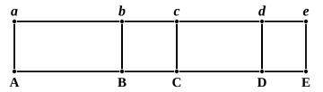

Then, since the rectangles $ac, be$ have the same height, they are to one another as their bases. [VI. 1]

$$\begin{aligned}
\text{Hence} \qquad P : Q &= ab : bf. \\
\text{But} \qquad P : Q &= R : S. \\
\text{Therefore} \quad R : S &= ab : bf, \qquad [\text{V. 11}] \\
\text{i.e.} \qquad \text{rect. } ag : \text{rect. } bk &= ab : bf.
\end{aligned}$$

Hence (by the converse of VI. 1) the rectangles $ag, bk$ have the same height, so that $k$ is on the line $hg$.

Hence the rectangles $ac, ag$ have the same height, namely $ab$; also $be, bk$ have the same height, namely $bf$.

$$\begin{aligned}
\text{Therefore} \qquad \text{rect. } ac : \text{rect. } ag &= bc : bg, \\
\text{and} \qquad \text{rect. } be : \text{rect. } bk &= bc : bg. && [\text{VI. 1}] \\
\text{Therefore} \qquad \text{rect. } ac : \text{rect. } ag &= \text{rect. } be : \text{rect. } bk. && [\text{V. 11}] \\
\text{That is,} \qquad P : R &= Q : S.
\end{aligned}$$

Secondly, let the magnitudes be straight lines $AB, BC, CD, DE$.

Construct the rectangles $Ab, Bc, Cd, De$ with the same height.

$$\begin{aligned}
\text{Then} \qquad Ab : Bc &= AB : BC, \\
\text{and} \qquad Cd : De &= CD : DE. && [\text{VI. 1}] \\
\text{But} \qquad AB : BC &= CD : DE. \\
\text{Therefore} \qquad Ab : Bc &= Cd : De. && [\text{V. 11}]
\end{aligned}$$

Hence, by the first case,

$$Ab : Cd = Bc : De,$$

and, since these rectangles have the same height,

$$AB : CD = BC : DE.$$

---

## PROPOSITION 17.

*If magnitudes be proportional componendo, they will also be proportional separando.*

Let $AB, BE, CD, DF$ be magnitudes proportional *componendo*, so that, as $AB$ is to $BE$, so is $CD$ to $DF$;
I say that they will also be proportional *separando*, that is, as $AE$ is to $EB$, so is $CF$ to $DF$.

For of $AE, EB, CF, FD$ let equimultiples $GH, HK, LM, MN$ be taken,
and of $EB, FD$ other, chance, equimultiples, $KO, NP$.
