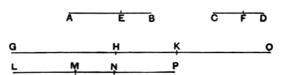

Then, since $GH$ is the same multiple of $AE$ that $HK$ is of $EB$,
therefore $GH$ is the same multiple of $AE$ that $GK$ is of $AB$. [V. 1]

But $GH$ is the same multiple of $AE$ that $LM$ is of $CF$;
therefore $GK$ is the same multiple of $AB$ that $LM$ is of $CF$.

Again, since $LM$ is the same multiple of $CF$ that $MN$ is of $FD$,
therefore $LM$ is the same multiple of $CF$ that $LN$ is of $CD$. [V. 1]

But $LM$ was the same multiple of $CF$ that $GK$ is of $AB$;
therefore $GK$ is the same multiple of $AB$ that $LN$ is of $CD$.

Therefore $GK, LN$ are equimultiples of $AB, CD$.

Again, since $HK$ is the same multiple of $EB$ that $MN$ is of $FD$,
and $KO$ is also the same multiple of $EB$ that $NP$ is of $FD$,
therefore the sum $HO$ is also the same multiple of $EB$ that $MP$ is of $FD$. [V. 2]

And, since, as $AB$ is to $BE$, so is $CD$ to $DF$,
and of $AB, CD$ equimultiples $GK, LN$ have been taken,
and of $EB, FD$ equimultiples $HO, MP$,
therefore, if $GK$ is in excess of $HO$, $LN$ is also in excess of $MP$,
if equal, equal,
and if less, less.

Let $GK$ be in excess of $HO$;
then, if $HK$ be subtracted from each,
$GH$ is also in excess of $KO$.

But we saw that, if $GK$ was in excess of $HO$, $LN$ was also in excess of $MP$;
therefore $LN$ is also in excess of $MP$,
