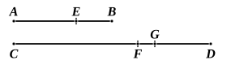

Subtract from $m(a + b), (m + n)b$ the common part $mb$, and from $m(c + d), (m + n)d$ the common part $md$; and we have,
according as $ma > = < nb, \quad mc > = < nd$.

But $ma, mc$ are any equimultiples of $a, c$, and $nb, nd$ any equimultiples of $b, d$,
therefore, by V. Def. 5,

$$a \text{ is to } b \text{ as } c \text{ is to } d.$$

Smith and Bryant's proof follows, *mutatis mutandis*, their alternative proof of the next proposition (see pp. 173—4 below).

---

## PROPOSITION 18.

*If magnitudes be proportional separando, they will also be proportional componendo.*

Let $AE, EB, CF, FD$ be magnitudes proportional *separando*, so that, as $AE$ is to $EB$, so is $CF$ to $FD$;
I say that they will also be proportional *componendo*, that is, as $AB$ is to $BE$, so is $CD$ to $FD$.

For, if $CD$ be not to $DF$ as $AB$ to $BE$,
then, as $AB$ is to $BE$, so will $CD$ be either to some magnitude less than $DF$ or to a greater.

First, let it be in that ratio to a less magnitude $DG$.

Then, since, as $AB$ is to $BE$, so is $CD$ to $DG$,
they are magnitudes proportional *componendo*;
so that they will also be proportional *separando*. [V. 17]

Therefore, as $AE$ is to $EB$, so is $CG$ to $GD$.

But also, by hypothesis,
as $AE$ is to $EB$, so is $CF$ to $FD$.

Therefore also, as $CG$ is to $GD$, so is $CF$ to $FD$. [V. 11]

But the first $CG$ is greater than the third $CF$;
therefore the second $GD$ is also greater than the fourth $FD$. [V. 14]

But it is also less: which is impossible.

Therefore, as $AB$ is to $BE$, so is not $CD$ to a less magnitude than $FD$.
