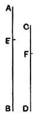
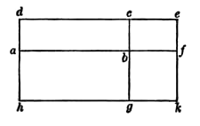

For, because $AE$ is to $EB$ as $CF$ is to $FD$,
therefore, alternately,
$$AE \text{ is to } CF \text{ as } EB \text{ is to } FD. \quad [\text{V. } 16]$$
And, as one of the antecedents is to its consequent, so is the sum of the antecedents to the sum of the consequents: $[\text{V. } 12]$
therefore, as $EB$ is to $FD$, so are $AE$, $EB$ together to $CF$, $FD$ together;
that is,
$$AB \text{ is to } CD \text{ as } EB \text{ is to } FD.$$
Therefore, alternately,
$$AB \text{ is to } BE \text{ as } CD \text{ is to } FD.\text{''}$$

The objection to this proof is that it is only valid in the case where the proposition V. 16 used in it is valid, i.e. where all four magnitudes are of the same kind.

Smith and Bryant's proof avails where all four magnitudes are straight lines, where all four magnitudes are rectilineal areas, or where one antecedent and its consequent are straight lines and the other antecedent and its consequent rectilineal areas.

Suppose that
$$A : B = C : D.$$

*First*, let all the magnitudes be areas.
Construct a rectangle $abcd$ equal to $A$, and to $bc$ apply the rectangle $bcef$ equal to $B$.
Also to $ab$, $bf$ apply the rectangles $ag$, $bk$ equal to $C$, $D$ respectively.

Then, since the rectangles $ac$, $be$ have equal heights $bc$, they are to one another as their bases. $[\text{VI. } 1]$
Hence
$$\begin{aligned}
ab : bf &= \text{rect. } ac : \text{rect. } be \\
&= A : B \\
&= C : D \\
&= \text{rect. } ag : \text{rect. } bk.
\end{aligned}$$

Therefore $[\text{VI. } 1\text{, converse}]$ the rectangles $ag$, $bk$ have the same height, so that $k$ is on the straight line $hg$.
Hence
$$\begin{aligned}
A + B : B &= \text{rect. } ae : \text{rect. } be \\
&= af : bf \\
&= \text{rect. } ak : \text{rect. } bk \\
&= C + D : D.
\end{aligned}$$

*Secondly*, let the magnitudes $A$, $B$ be straight lines and the magnitudes $C$, $D$ areas.
Let $ab$, $bf$ be equal to the straight lines $A$, $B$, and to $ab$, $bf$ apply the rectangles $ag$, $bk$ equal to $C$, $D$ respectively.
Then, as before, the rectangles $ag$, $bk$ have the same height.
Now
$$\begin{aligned}
A + B : B &= af : bf \\
&= \text{rect. } ak : \text{rect. } bk \\
&= C + D : D.
\end{aligned}$$

*Thirdly*, let all the magnitudes be straight lines.
Apply to the straight lines $C$, $D$ rectangles $P$, $Q$ having the same height.
