Then
$$P : Q = C : D. \quad [\text{VI. } 1]$$
Hence, by the second case,
$$A + B : B = P + Q : Q.$$
Also
$$P + Q : Q = C + D : D.$$
Therefore
$$A + B : B = C + D : D.$$

---

### PROPOSITION 19.

*If, as a whole is to a whole, so is a part subtracted to a part subtracted, the remainder will also be to the remainder as whole to whole.*

For, as the whole $AB$ is to the whole $CD$, so let the part $AE$ subtracted be to the part $CF$ subtracted;
I say that the remainder $EB$ will also be to the remainder $FD$ as the whole $AB$ to the whole $CD$.

For since, as $AB$ is to $CD$, so is $AE$ to $CF$,
alternately also, as $BA$ is to $AE$, so is $DC$ to $CF$. $[\text{V. } 16]$

And, since the magnitudes are proportional *componendo*, they will also be proportional *separando*, $[\text{V. } 17]$
that is, as $BE$ is to $EA$, so is $DF$ to $CF$,
and, alternately,
$$\text{as } BE \text{ is to } DF\text{, so is } EA \text{ to } FC. \quad [\text{V. } 16]$$

But, as $AE$ is to $CF$, so by hypothesis is the whole $AB$ to the whole $CD$.

Therefore also the remainder $EB$ will be to the remainder $FD$ as the whole $AB$ is to the whole $CD$. $[\text{V. } 11]$

Therefore etc.

[PORISM. From this it is manifest that, if magnitudes be proportional *componendo*, they will also be proportional *convertendo*.]

Q. E. D.

---

Algebraically, if $a : b = c : d$ (where $c < a$ and $d < b$), then
$$(a - c) : (b - d) = a : b.$$

The "Porism" at the end of this proposition is led up to by a few lines which Heiberg brackets because it is not Euclid's habit to explain a Porism, and indeed a Porism, from its very nature, should not need any
