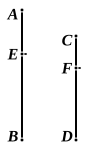

explanation, being a sort of by-product appearing without effort or trouble, ἀπραγματεύτως (Proclus, p. 303, 6). But Heiberg thinks that Simson does wrong in finding fault with the argument leading to the "Porism," and that it does contain the true demonstration of *conversion* of a ratio. In this it appears to me that Heiberg is clearly mistaken, the supposed proof on the basis of Prop. 19 being no more correct than the similar attempt to prove the *inversion* of a ratio from Prop. 4. The words are: "And since it was proved that, as $AB$ is to $CD$, so is $EB$ to $FD$,
$$\text{alternately also, as } AB \text{ is to } BE\text{, so is } CD \text{ to } FD\text{:}$$
$$\text{therefore magnitudes when compounded are proportional.}$$
But it was proved that, as $BA$ is to $AE$, so is $DC$ to $CF$, and this is *convertendo*."

It will be seen that this amounts to proving *from the hypothesis* $a : b = c : d$ that the following transformations are simultaneously true, viz.:
$$a : a - c = b : b - d,$$
and
$$a : c = b : d.$$
The former is not proved from the latter as it ought to be if it were intended to prove *conversion*.

The inevitable conclusion is that both the "Porism" and the argument leading up to it are interpolations, though no doubt made, as Heiberg says, before Theon's time.

The *conversion* of ratios does not depend upon V. 19 at all but, as Simson shows in his Proposition E (containing a proof already given by Clavius), on Props. 17 and 18. Prop. E is as follows.

*If four magnitudes be proportionals, they are also proportionals by conversion, that is, the first is to its excess above the second as the third is to its excess above the fourth.*

Let $AB$ be to $BE$ as $CD$ to $DF$:
then $BA$ is to $AE$ as $DC$ to $CF$.

Because $AB$ is to $BE$ as $CD$ to $DF$,
by division [*separando*],
$$AE \text{ is to } EB \text{ as } CF \text{ to } FD, \quad [\text{V. } 17]$$
and, by inversion,
$$BE \text{ is to } EA \text{ as } DF \text{ to } FC.$$
$$[\text{Simson's Prop. B directly obtained from V. Def. } 5]$$
Wherefore, by composition [*componendo*],
$$BA \text{ is to } AE \text{ as } DC \text{ to } CF. \quad [\text{V. } 18]$$

---

### PROPOSITION 20.

*If there be three magnitudes, and others equal to them in multitude, which taken two and two are in the same ratio, and if* ex aequali *the first be greater than the third, the fourth will also be greater than the sixth; if equal, equal; and, if less, less.*
