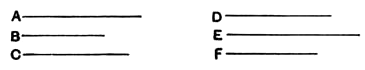

Next, let $A$ be less than $C$; then shall $D$ be less than $F$.
For $C$ is greater than $A$,
and, as was shown in the first case,
$$C \text{ is to } B \text{ as } F \text{ to } E,$$
and, in like manner,
$$B \text{ is to } A \text{ as } E \text{ to } D;$$
therefore $F$ is greater than $D$, by the first case; and therefore $D$ is less than $F$."

---

### PROPOSITION 21.

*If there be three magnitudes, and others equal to them in multitude, which taken two and two together are in the same ratio, and the proportion of them be perturbed, then, if* ex aequali *the first magnitude is greater than the third, the fourth will also be greater than the sixth; if equal, equal; and if less, less.*

Let there be three magnitudes $A$, $B$, $C$, and others $D$, $E$, $F$ equal to them in multitude, which taken two and two are in the same ratio, and let the proportion of them be perturbed, so that,
$$\text{as } A \text{ is to } B\text{, so is } E \text{ to } F,$$
and,
$$\text{as } B \text{ is to } C\text{, so is } D \text{ to } E,$$
and let $A$ be greater than $C$ *ex aequali*;
I say that $D$ will also be greater than $F$; if $A$ is equal to $C$, equal; and if less, less.

For, since $A$ is greater than $C$,
and $B$ is some other magnitude,
therefore $A$ has to $B$ a greater ratio than $C$ has to $B$. $[\text{V. } 8]$

But, as $A$ is to $B$, so is $E$ to $F$,
and, as $C$ is to $B$, inversely, so is $E$ to $D$.
Therefore also $E$ has to $F$ a greater ratio than $E$ has to $D$. $[\text{V. } 13]$

But that to which the same has a greater ratio is less; $[\text{V. } 10]$
therefore $F$ is less than $D$;
therefore $D$ is greater than $F$.
