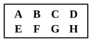

For of $A$, $D$ let equimultiples $G$, $H$ be taken,
and of $B$, $E$ other, chance, equimultiples $K$, $L$;
and, further, of $C$, $F$ other, chance, equimultiples $M$, $N$.

Then, since, as $A$ is to $B$, so is $D$ to $E$,
and of $A$, $D$ equimultiples $G$, $H$ have been taken,
and of $B$, $E$ other, chance, equimultiples $K$, $L$,
therefore, as $G$ is to $K$, so is $H$ to $L$. [v. 4]

For the same reason also,
$$\text{as } K \text{ is to } M\text{, so is } L \text{ to } N.$$

Since, then, there are three magnitudes $G$, $K$, $M$, and others $H$, $L$, $N$ equal to them in multitude, which taken two and two together are in the same ratio,
therefore, *ex aequali*, if $G$ is in excess of $M$, $H$ is also in excess of $N$;
if equal, equal; and if less, less. [v. 20]

And $G$, $H$ are equimultiples of $A$, $D$,
and $M$, $N$ other, chance, equimultiples of $C$, $F$.

Therefore, as $A$ is to $C$, so is $D$ to $F$. [v. Def. 5]

Therefore etc.

Q. E. D.

---

Euclid enunciates this proposition as true of *any number of magnitudes whatever* forming two sets connected in the manner described, but his proof is confined to the case where each set consists of three magnitudes only. The extension to any number of magnitudes is, however, easy, as shown by Simson.

"Next let there be four magnitudes $A$, $B$, $C$, $D$, and other four $E$, $F$, $G$, $H$, which two and two have the same ratio, viz.:
$$\begin{aligned}
\text{as } A \text{ is to } B\text{, so is } E \text{ to } F\text{,} \\
\text{and } \quad \text{as } B \text{ is to } C\text{, so is } F \text{ to } G\text{,} \\
\text{and } \quad \text{as } C \text{ is to } D\text{, so is } G \text{ to } H\text{;}
\end{aligned}$$
$A$ shall be to $D$ as $E$ to $H$.

Because $A$, $B$, $C$ are three magnitudes, and $E$, $F$, $G$ other three, which taken two and two have the same ratio,
by the foregoing case,
$$A \text{ is to } C \text{ as } E \text{ to } G.$$
