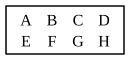

over), but it is open to the objection that it uses v. 16 which is only applicable 
if the four magnitudes are *of the same kind*; whereas v. 23, the proposition 
now in question, is not subject to this restriction.

Simson rightly observes that in the last step of the proof it should be stated that "$G$, $K$ are *any equimultiples whatever* of $A$, $D$, and $L$, $N$ *any whatever* of $C$, $F$."

He also gives the extension of the proposition to any number of magnitudes, 
enunciating it thus:

"If there be any number of magnitudes, and as many others, which, taken 
two and two, in a cross order, have the same ratio; the first shall have to the 
last of the first magnitudes the same ratio which the first of the others has to 
the last"; 
and adding to the proof as follows:

"Next, let there be four magnitudes $A$, $B$, $C$, $D$, and other four $E$, $F$, $G$, $H$, which, taken two and two in a cross order, have the same ratio, viz.:
$A$ to $B$ as $G$ to $H$,
$B$ to $C$ as $F$ to $G$,
and $C$ to $D$ as $E$ to $F$;
then $A$ is to $D$ as $E$ to $H$.

Because $A$, $B$, $C$ are three magnitudes, and $F$, $G$, $H$ other three which, taken two and two in a cross order, have the same ratio,
by the first case,
$A$ is to $C$ as $F$ to $H$.
But
$C$ is to $D$ as $E$ to $F$;
wherefore again, by the first case,
$A$ is to $D$ as $E$ to $H$.
And so on, whatever be the number of magnitudes."

---

### PROPOSITION 24.

If a first magnitude have to a second the same ratio as a 
third has to a fourth, and also a fifth have to the second the 
same ratio as a sixth to the fourth, the first and fifth added 
together will have to the second the same ratio as the third and 
sixth have to the fourth.

Let a first magnitude $AB$ have to a second $C$ the same ratio as a third $DE$ has to a fourth $F$;
and let also a fifth $BG$ have to the second $C$ the same ratio as a sixth $EH$ has to the fourth $F$;
I say that the first and fifth added together, $AG$, will have to the second $C$ the same ratio as the third and sixth, $DH$, has to the fourth $F$.

