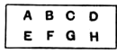
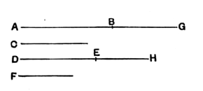

over), but it is open to the objection that it uses v. 16 which is only applicable if the four magnitudes are *of the same kind*; whereas v. 23, the proposition now in question, is not subject to this restriction.

Simson rightly observes that in the last step of the proof it should be stated that "$G$, $K$ are *any equimultiples whatever* of $A$, $D$, and $L$, $N$ *any whatever* of $C$, $F$."

He also gives the extension of the proposition to any number of magnitudes, enunciating it thus:

"If there be any number of magnitudes, and as many others, which, taken two and two, in a cross order, have the same ratio; the first shall have to the last of the first magnitudes the same ratio which the first of the others has to the last";
and adding to the proof as follows:

"Next, let there be four magnitudes $A$, $B$, $C$, $D$, and other four $E$, $F$, $G$, $H$, which, taken two and two in a cross order, have the same ratio, viz.:
$$\begin{aligned}
A \text{ to } B & \text{ as } G \text{ to } H\text{,} \\
B \text{ to } C & \text{ as } F \text{ to } G\text{,} \\
\text{and } \quad C \text{ to } D & \text{ as } E \text{ to } F\text{;}
\end{aligned}$$
then $A$ is to $D$ as $E$ to $H$.

Because $A$, $B$, $C$ are three magnitudes, and $F$, $G$, $H$ other three which, taken two and two in a cross order, have the same ratio,
by the first case,
$$A \text{ is to } C \text{ as } F \text{ to } H.$$
But
$$C \text{ is to } D \text{ as } E \text{ to } F\text{;}$$
wherefore again, by the first case,
$$A \text{ is to } D \text{ as } E \text{ to } H.$$
And so on, whatever be the number of magnitudes."

---

### PROPOSITION 24.

*If a first magnitude have to a second the same ratio as a third has to a fourth, and also a fifth have to the second the same ratio as a sixth to the fourth, the first and fifth added together will have to the second the same ratio as the third and sixth have to the fourth.*

Let a first magnitude $AB$ have to a second $C$ the same ratio as a third $DE$ has to a fourth $F$;
and let also a fifth $BG$ have to the second $C$ the same ratio as a sixth $EH$ has to the fourth $F$;
I say that the first and fifth added together, $AG$, will have to the second $C$ the same ratio as the third and sixth, $DH$, has to the fourth $F$.

