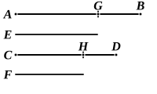

### PROPOSITION 25.

If four magnitudes be proportional, the greatest and the 
least are greater than the remaining two.

Let the four magnitudes $AB$, $CD$, $E$, $F$ be proportional so that, as $AB$ is to $CD$, so is $E$ to $F$, and let $AB$ be the greatest of them and $F$ the least;
I say that $AB$, $F$ are greater than $CD$, $E$.

For let $AG$ be made equal to $E$, and $CH$ equal to $F$.

Since, as $AB$ is to $CD$, so is $E$ to $F$,
and $E$ is equal to $AG$, and $F$ to $CH$,
therefore, as $AB$ is to $CD$, so is $AG$ to $CH$.

And since, as the whole $AB$ is to the whole $CD$, so is the part $AG$ subtracted to the part $CH$ subtracted,
the remainder $GB$ will also be to the remainder $HD$ as the whole $AB$ is to the whole $CD$. [v. 19]

But $AB$ is greater than $CD$;
therefore $GB$ is also greater than $HD$.

And, since $AG$ is equal to $E$, and $CH$ to $F$,
therefore $AG$, $F$ are equal to $CH$, $E$.

And if, $GB$, $HD$ being unequal, and $GB$ greater, $AG$, $F$ be added to $GB$ and $CH$, $E$ be added to $HD$,
it follows that $AB$, $F$ are greater than $CD$, $E$.

Therefore etc.

Q. E. D.

---

Algebraically, if
$$a : b = c : d\text{,}$$
and $a$ is the greatest of the four magnitudes and $d$ the least,
$$a + d > b + c.$$

Simson is right in inserting a word in the setting-out, "let $AB$ be the greatest of them and *<consequently>* $F$ the least." This follows from the particular case, really included in Def. 5, which Simson makes the subject of his proposition A, the case namely where the equimultiples taken are once the several magnitudes.

The proof is as follows. 
Since
$$a : b = c : d\text{,}$$
$$a - c : b - d = a : b. \qquad [\text{V. } 19]$$
