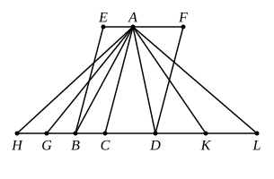

# BOOK VI. PROPOSITIONS.

### PROPOSITION 1.

*Triangles and parallelograms which are under the same height are to one another as their bases.*

Let *ABC*, *ACD* be triangles and *EC*, *CF* parallelograms under the same height;
5I say that, as the base *BC* is to the base *CD*, so is the triangle *ABC* to the triangle *ACD*, and the parallelogram *EC* to the parallelogram *CF*.

For let *BD* be produced in both directions to the points *H*, *L* and let [any number of straight lines] *BG*, *GH* be 10made equal to the base *BC*, and any number of straight lines *DK*, *KL* equal to the base *CD*;
let *AG*, *AH*, *AK*, *AL* be joined.

Then, since *CB*, *BG*, *GH* are equal to one another,
the triangles *ABC*, *AGB*, *AHG* are also equal to one 15another. [I. 38]

Therefore, whatever multiple the base *HC* is of the base *BC*, that multiple also is the triangle *AHC* of the triangle *ABC*.

For the same reason,
20whatever multiple the base *LC* is of the base *CD*, that multiple also is the triangle *ALC* of the triangle *ACD*;
and, if the base *HC* is equal to the base *CL*, the triangle *AHC* is also equal to the triangle *ACL*, [I. 38]
