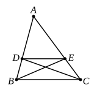

Then the rectangles ">$ABCD$, ">$AIKD$ are in the ratio of the bases $AB$, $AI$, since the latter are commensurable.

Therefore, inverting the proportion,
rect. ">$AIKD$ : rect. ">$ABCD$ = $AI$ : $AB$...........................(2).

From this and (1), *ex aequali*,
rect. ">$AIKD$ : rect. ">$AEFD$ = $AI$ : $AO$.

But $AO$ > $AI$; therefore rect. ">$AEFD$ > rect. ">$AIKD$.

But this is impossible, for the rectangle ">$AEFD$ is less than the rectangle ">$AIKD$.

Similarly an impossibility can be proved if $AO$ < $AE$.

Therefore
rect. ">$ABCD$ : rect. ">$AEFD$ = $AB$ : $AE$.

Some modern American and German text-books adopt the less rigorous method of appealing to the theory of *limits*.

---

### PROPOSITION 2.

*If a straight line be drawn parallel to one of the sides of a triangle, it will cut the sides of the triangle proportionally; and, if the sides of the triangle be cut proportionally, the line joining the points of section will be parallel to the remaining side of the triangle.*

For let $DE$ be drawn parallel to $BC$, one of the sides of the triangle ">$ABC$;
I say that, as $BD$ is to $DA$, so is $CE$ to $EA$.

For let $BE$, $CD$ be joined.

Therefore the triangle ">$BDE$ is equal to the triangle ">$CDE$;
for they are on the same base $DE$ and in the same parallels $DE$, $BC$. [I. 38]

And the triangle ">$ADE$ is another area.

But equals have the same ratio to the same; [v. 7]
therefore, as the triangle ">$BDE$ is to the triangle ">$ADE$, so is the triangle ">$CDE$ to the triangle ">$ADE$.

But, as the triangle ">$BDE$ is to ">$ADE$, so is $BD$ to $DA$;
for, being under the same height, the perpendicular drawn from $E$ to $AB$, they are to one another as their bases. [VI. 1]

For the same reason also,
as the triangle ">$CDE$ is to ">$ADE$, so is $CE$ to $EA$.

Therefore also, as $BD$ is to $DA$, so is $CE$ to $EA$. [v. 11]
