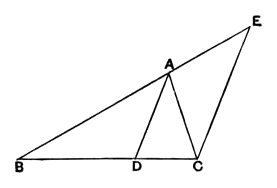

*remaining sides of the triangle, the straight line joined from the vertex to the point of section will bisect the angle of the triangle.*

Let *ABC* be a triangle, and let the angle *BAC* be bisected by the straight line *AD*;

I say that, as *BD* is to *CD*, so is *BA* to *AC*.

For let *CE* be drawn through *C* parallel to *DA*, and let *BA* be carried through and meet it at *E*.

Then, since the straight line *AC* falls upon the parallels *AD*, *EC*,
the angle *ACE* is equal to the angle *CAD*. [I. 29]

But the angle *CAD* is by hypothesis equal to the angle *BAD*;
therefore the angle *BAD* is also equal to the angle *ACE*.

Again, since the straight line *BAE* falls upon the parallels *AD*, *EC*,
the exterior angle *BAD* is equal to the interior angle *AEC*. [I. 29]

But the angle *ACE* was also proved equal to the angle *BAD*;
therefore the angle *ACE* is also equal to the angle *AEC*,
so that the side *AE* is also equal to the side *AC*. [I. 6]

And, since *AD* has been drawn parallel to *EC*, one of the sides of the triangle *BCE*,
therefore, proportionally, as *BD* is to *DC*, so is *BA* to *AE*. [VI. 2]

But *AE* is equal to *AC*;
therefore, as *BD* is to *DC*, so is *BA* to *AC*.

Again, let *BA* be to *AC* as *BD* to *DC*, and let *AD* be joined;

I say that the angle *BAC* has been bisected by the straight line *AD*.

For, with the same construction,
since, as *BD* is to *DC*, so is *BA* to *AC*,
