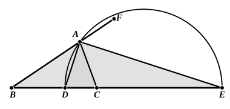

VI. 3 can be used almost word for word for the other case. We have only to speak of the angle "$FAC$" for the angle "$BAC$," and of the angle "$FAD$" for the angle "$BAD$" wherever they occur, to say "let $BA$, or $BA$ produced, meet $CE$ in $E$," and to substitute "$BA$ or $BA$ produced" for "$BAE$" lower down.

If $AD$, $AE$ be the internal and external bisectors of the angle $A$ in a triangle of which the sides $AB$, $AC$ are unequal, $AC$ being the smaller, and if $AD$, $AE$ meet $BC$ and $BC$ produced in $D$, $E$ respectively,
the ratios of $BD$ to $DC$ and of $BE$ to $EC$ are alike equal to the ratio of $BA$ to $AC$.

Therefore

$BE$ is to $EC$ as $BD$ to $DC$,

that is, $BE$ is to $EC$ as the difference between $BE$ and $ED$ is to the difference between $ED$ and $EC$,
whence $BE$, $ED$, $EC$ are in *harmonic progression*, or $DE$ is a *harmonic mean* between $BE$ and $EC$, or again $B$, $D$, $C$, $E$ is a *harmonic range*.

Since the angle $DAC$ is half of the angle $BAC$,
and the angle $CAE$ half of the angle $CAF$,
while the angles $BAC$, $CAF$ are equal to two right angles,
the angle $DAE$ is a right angle.

Hence the circle described on $DE$ as diameter passes through $A$.

Now, if the ratio of $BA$ to $AC$ is given, and if $BC$ is given, the points $D$, $E$ on $BC$ and $BC$ produced are given, and therefore so is the circle on $D$, $E$ as diameter. Hence *the locus of a point such that its distances from two given points are in a given ratio (not being a ratio of equality) is a circle*.

This locus was discussed by Apollonius in his *Plane Loci*, Book II., as we know from Pappus (VII. p. 666), who says that the book contained the theorem that, if from two given points straight lines inflected to another point are in a given ratio, the point in which they meet will lie on either a straight line or a circumference of a circle. The straight line is of course the locus when the ratio is one of equality. The other case is quoted in the following form by Eutocius (Apollonius, ed. Heiberg, II. pp. 180—4).

*Given two points in a plane and a proportion between unequal straight lines, it is possible to describe a circle in the plane so that the straight lines inflected from the given points to the circumference of the circle shall have a ratio the same as the given one.*

Apollonius' construction, as given by Eutocius, is remarkable because he makes no use of either of the points $D$, $E$. He finds $O$, the centre of the required circle, and the length of its radius directly from the data $BC$ and the given ratio which we will call $h : k$. But the construction was not discovered by Apollonius; it belongs to a much earlier date, since it appears in exactly
