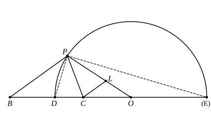

the same form in Aristotle, *Meteorologica* III. 5, 376 a 3 sqq. The analysis leading up to the construction is, as usual, not given either by Aristotle or Eutocius. We are told to take three straight lines $x$, $CO$ (a length measured along $BC$ produced beyond $C$, where $B$, $C$ are the points at which the greater and smaller of the inflected lines respectively terminate), and $r$, such that, if $h : k$ be the given ratio and $h > k$,

$k : h = h : k + x$, $(\alpha)$

$x :$ $BC$ $= k :$ $CO$ $= h : r$. $(\beta)$

This determines the position of $O$, and the length of $r$, the radius of the required circle. The circle is then drawn, any point $P$ is taken on it and joined to $B$, $C$ respectively, and it is proved that

$PB$ $:$ $PC$ $= h : k$.

We may conjecture that the analysis proceeded somewhat as follows.

It would be seen that $B$, $C$ are "conjugate points" with reference to the circle on $DE$ as diameter. (*Cf.* Apollonius, *Conics*, I. 36, where it is proved, in terms, for a circle as well as for an ellipse and a hyperbola, that, if the polar of $B$ meets the diameter $DE$ in $C$, then $EC$ $:$ $CD$ $=$ $EB$ $:$ $BD$.)

If $O$ be the middle point of $DE$, and therefore the centre of the circle, $D$, $E$ may be eliminated, as in the *Conics*, I. 37, thus.

Since

$EC$ $:$ $CD$ $=$ $EB$ $:$ $BD$,

it follows that $EC$ $+$ $CD$ $:$ $EC$ $\sim$ $CD$ $=$ $EB$ $+$ $BD$ $:$ $EB$ $\sim$ $BD$,
or

$2$$OD$ $: 2$$OC$ $= 2$$OB$ $: 2$$OD$,

that is,

$BO$ $\cdot$ $OC$ $=$ $OD^2$ $= r^2$, say.

If therefore $P$ be any point on the circle with centre $O$ and radius $r$,

$BO$ $:$ $OP$ $=$ $OP$ $:$ $OC$,

so that $BOP$, $POC$ are similar triangles.

In addition, $h : k =$ $BD$ $:$ $DC$ $=$ $BE$ $:$ $EC$

$=$ $BD$ $+$ $BE$ $:$ $DE$ $=$ $BO$ $: r$.

Hence we require that

$BO$ $: r = r :$ $OC$ $=$ $BP$ $:$ $PC$ $= h : k$. $(\delta)$

Therefore, alternately,

$k :$ $CO$ $= h : r$,

which is the second relation in $(\beta)$ above.

Now assume a length $x$ such that each of the last ratios is equal to $x :$ $BC$, as in $(\beta)$.
