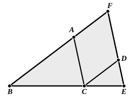

Let ">$ABC$, ">$DCE$ be equiangular triangles having the 
angle $ABC$ equal to the angle 
$DCE$, the angle $BAC$ to the 
angle $CDE$, and further the angle 
$ACB$ to the angle $CED$;

I say that in the triangles ">$ABC$, 
">$DCE$ the sides about the equal 
angles are proportional, and those 
are corresponding sides which 
subtend the equal angles.

For let $BC$ be placed in a 
straight line with $CE$.

Then, since the angles $ABC$, $ACB$ are less than two right 
angles, [I. 17] 
and the angle $ACB$ is equal to the angle $DEC$,

therefore the angles $ABC$, $DEC$ are less than two right 
angles;

therefore $BA$, $ED$, when produced, will meet. [I. Post. 5]

Let them be produced and meet at $F$.

Now, since the angle $DCE$ is equal to the angle $ABC$,

$BF$ is parallel to $CD$. [I. 28]

Again, since the angle $ACB$ is equal to the angle $DEC$,

$AC$ is parallel to $FE$. [I. 28]

Therefore ">$FACD$ is a parallelogram;

therefore $FA$ is equal to $DC$, and $AC$ to $FD$. [I. 34]

And, since $AC$ has been drawn parallel to $FE$, one side 
of the triangle ">$FBE$,

therefore, as $BA$ is to $AF$, so is $BC$ to $CE$. [VI. 2]

But $AF$ is equal to $CD$;

therefore, as $BA$ is to $CD$, so is $BC$ to $CE$, 
and alternately, as $AB$ is to $BC$, so is $DC$ to $CE$. [V. 16]

Again, since $CD$ is parallel to $BF$,

therefore, as $BC$ is to $CE$, so is $FD$ to $DE$. [VI. 2]

But $FD$ is equal to $AC$;

therefore, as $BC$ is to $CE$, so is $AC$ to $DE$, 
and alternately, as $BC$ is to $CA$, so is $CE$ to $ED$. [V. 16]

