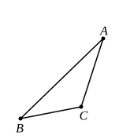
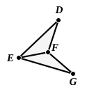

therefore the remaining angle at $A$ is equal to the remaining 
angle at $G$. [I. 32]

Therefore the triangle ">$ABC$ is equiangular with the 
triangle ">$GEF$.

Therefore in the triangles ">$ABC$, ">$GEF$ the sides about 
the equal angles are proportional, and those are corresponding 
sides which subtend the equal angles; [VI. 4]

therefore, as $AB$ is to $BC$, so is $GE$ to $EF$.

But, as $AB$ is to $BC$, so by hypothesis is $DE$ to $EF$;

therefore, as $DE$ is to $EF$, so is $GE$ to $EF$. [V. 11]

Therefore each of the straight lines $DE$, $GE$ has the 
same ratio to $EF$;

therefore $DE$ is equal to $GE$. [V. 9]

For the same reason

$DF$ is also equal to $GF$.

Since then $DE$ is equal to $EG$, 
and $EF$ is common,

the two sides $DE$, $EF$ are equal to the two sides $GE$, $EF$;

and the base $DF$ is equal to the base $FG$;

therefore the angle $DEF$ is equal to the angle $GEF$, [I. 8]

and the triangle ">$DEF$ is equal to the triangle ">$GEF$, 
and the remaining angles are equal to the remaining angles, 
namely those which the equal sides subtend. [I. 4]

Therefore the angle $DFE$ is also equal to the angle $GFE$, 
and the angle $EDF$ to the angle $EGF$.

And, since the angle $FED$ is equal to the angle $GEF$,

while the angle $GEF$ is equal to the angle $ABC$,

therefore the angle $ABC$ is also equal to the angle $DEF$.

